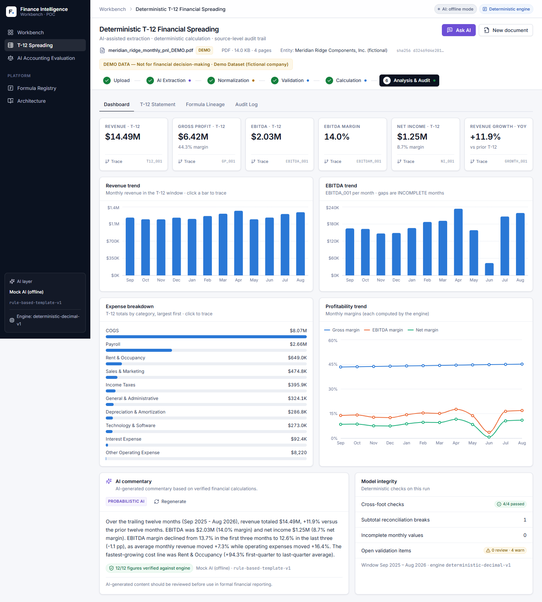

# Finance Intelligence Workbench (POC)

**AI-powered financial analysis with deterministic calculations and audit-grade traceability.**

> AI can reason about financial information. Deterministic systems calculate the numbers.
> Every important result remains explainable and traceable.

One platform with two modules that share an LLM layer, an agent layer and an audit layer:

| Module | What it demonstrates |
|---|---|
| **Deterministic T-12 Financial Spreading** | Upload a monthly P&L (PDF / XLSX / CSV) → AI-assisted extraction → normalization with human-in-the-loop control → validation → deterministic formula engine → T-12 statement, dashboard, AI commentary, a finance assistant, and a cell-level audit trail. |
| **Enterprise AI Accounting Evaluation** | A 15-dimension, evidence-based framework for comparing AI accounting / FP&A platforms: evidence, vendor claims, test results, documentation references, limitations, and a generated report. |



---

## Quick start

Prerequisites: **Python 3.10+** and **Node 18+** (tested with Python 3.10.11, Node 24).

### 1. Backend (FastAPI), port 8000

```bash
cd backend
python -m venv .venv
# Windows:  .venv\Scripts\activate      macOS/Linux:  source .venv/bin/activate
pip install -r requirements.txt        # or with uv:  uv pip install -r requirements.txt
uvicorn app.main:app --reload --port 8000
```

API docs: http://127.0.0.1:8000/docs

### 2. Frontend (React + Vite), port 5173

```bash
cd frontend
npm install
npm run dev
```

Open **http://localhost:5173**. The dev server proxies `/api` to `http://127.0.0.1:8000` (override it with `VITE_API_TARGET`).

### 3. Optional: enable Groq

The POC runs fully offline. Without an API key, the AI layer uses a **deterministic stand-in** that is clearly labelled "AI: offline mode" throughout the UI. To use Groq (get a key at https://console.groq.com/keys):

```bash
# backend/.env is NOT loaded automatically; export the variable in the shell that runs uvicorn
export GROQ_API_KEY=gsk_...                    # PowerShell: $env:GROQ_API_KEY="gsk_..."
export GROQ_MODEL=llama-3.3-70b-versatile      # optional, this is the default (must support tool calling)
```

When the key is set, Groq is used for document classification, mapping suggestions for labels the rules cannot map, commentary, and the tool-calling assistant. It is **never** used for arithmetic. If a call fails, the app falls back to the offline path and says so in the UI. See `backend/.env.example`.

### Tests

```bash
cd backend && python -m pytest -q        # 42 tests: engine, evaluator, pipeline, lineage, AI guard, audit chain, Groq provider (fake client)
cd frontend && npm run typecheck && npm run build
```

---

## Demo script (about 5 minutes)

1. **Workbench.** Explain the two modules and the hybrid architecture (AI reasoning → deterministic calculation → trust & audit).
2. **Open T-12 Workspace → Run demo dataset** (PDF, XLSX or CSV). The demo is a *fictional* company rendered into a real document and processed by the same pipeline as an upload. It is labelled **DEMO DATA — Not for financial decision-making** everywhere.
3. **AI Extraction.** 18 rows × 24 months, each with a page or cell reference and a confidence score. The agent timeline shows Coordinator → Ingestion → Normalization → Validation.
4. **Normalization.** "Net Sales" → Revenue (exact synonym). "Depreciation & Amort." is a fuzzy match (WARNING, confirm it). **"Misc. adjustments (see note 7)" is unmapped (REVIEW REQUIRED)**: map it to *Other Operating Expense*. The change is written to the audit log.
5. **Validation.** Watch the subtotal reconciliations turn VALID once the misc row is mapped. What remains:
   - **Missing value.** Travel & Entertainment, Feb 2026. It is *not* estimated. Enter `7600` with a justification: the source's printed "Total Operating Expenses" implies 7,600, and reconciliation confirms it. Try another number and watch reconciliation flag it.
   - **Outlier.** A one-off rent spike (lease exit fee) is flagged, not changed.
   - **Source error.** The printed Net Income for Mar 2026 has transposed digits. The engine recomputes the value and flags the variance.
   - You can also skip the missing value. Dependent metrics then show **INCOMPLETE** instead of an invented number (see `docs/screenshots/21-dashboard-incomplete.png`).
6. **Run deterministic calculation.** The engine run shows the topological formula order, 216 results, cross-foot checks, reconciliation breaks, and "LLM involvement: none".
7. **Dashboard.** Six KPI cards and four charts, all from engine values. **Click EBITDA** to open the Audit Trail: source document → extracted values → normalized categories → formula `T12_001` → result. Click **Mar '26** to drill into `EBITDA_001 = gross_profit - operating_expenses` with the substituted numbers and the PDF page and raw token of every input.
8. **AI commentary.** The badge shows "N/N figures verified against engine". Every number in the text was matched to an engine value.
9. **Ask AI.** Try *"Why did EBITDA change?"* and *"Show me the calculation for EBITDA"*. Expand "deterministic tool calls" to see exactly which engine functions produced the numbers.
10. **T-12 Statement / Formula Lineage / Audit Log.** A sticky-column statement with expandable opex; a formula DAG; a hash-chained audit log ("Chain verified").
11. **AI Accounting Evaluation → Load illustrative example.** Open the matrix, add evidence to a cell, compare in the summary, and generate or download the report.

---

## Repository layout

```
backend/
  app/
    api/            routes.py (thin HTTP layer; no calculations)
    agents/         pipeline.py (Coordinator → Ingestion → Normalization → Validation → Calculation → Synthesis)
    extraction/     PDF / XLSX / CSV table extractors + period/number parsing
    normalization/  taxonomy + rules-first mapper (exact → fuzzy → AI suggestion → unmapped)
    calculations/   expression.py (safe Decimal AST evaluator), formulas.py (registry), engine.py
    audit/          log.py (hash-chained events), lineage.py (result → formula → source cells)
    services/       workspace + validation rules, llm.py (Groq / offline provider), finance_tools.py (AI tools), evaluation.py
    models/         domain.py (Document, FinancialPeriod, FinancialValue, Formula, CalculationResult, SourceReference, AuditEvent, NormalizedCategory, ...)
    data/           demo.py (fictional dataset → real PDF/XLSX/CSV)
  tests/            test_expression.py, test_engine.py, test_pipeline.py
frontend/
  src/
    components/     Button, Card, MetricCard, StatusBadge, FileUploader, AuditDrawer, FormulaViewer (+DependencyGraph),
                    FinancialChart, Stepper, Overlay (Drawer/Modal/Tooltip), Feedback (Empty/Loading/Error/Success), Markdown, ErrorBoundary
    features/t12/   Upload, Extraction, Normalization, Validation, Calculation, Dashboard, T12Table, Commentary, AssistantPanel, AuditLogView
    features/evaluation/
    pages/ layouts/ hooks/ services/ types/ lib/
docs/
  ARCHITECTURE.md
  screenshots/
```

See **[docs/ARCHITECTURE.md](docs/ARCHITECTURE.md)** for the design, including how probabilistic AI and deterministic computation are separated.

---

## What is real vs. simplified in this POC

| Real | Simplified / out of scope |
|---|---|
| Deterministic Decimal formula engine, T-12, margins, growth, reconciliation, cross-foot | Chart of accounts limited to a P&L taxonomy (plus AP/AR memo rows) |
| PDF (text layer), XLSX and CSV extraction with page/cell provenance | No OCR for scanned PDFs; tables must have one column per month |
| Validation rules, human resolutions with justification | State is in memory: restarting the backend clears workspaces |
| Hash-chained audit log, cell-level lineage | No authentication or multi-tenancy |
| Groq integration (classification, mapping suggestions, commentary, tool-calling assistant) + numeric-claim guard | The live Groq path needs `GROQ_API_KEY`; without one the offline stand-in is used and labelled |
| Evaluation framework with transparent weighted index | Evaluation state lives in browser `localStorage` |

No metric is presented as a calculation unless the engine produced it. Missing data is never invented: it propagates as **INCOMPLETE**.
